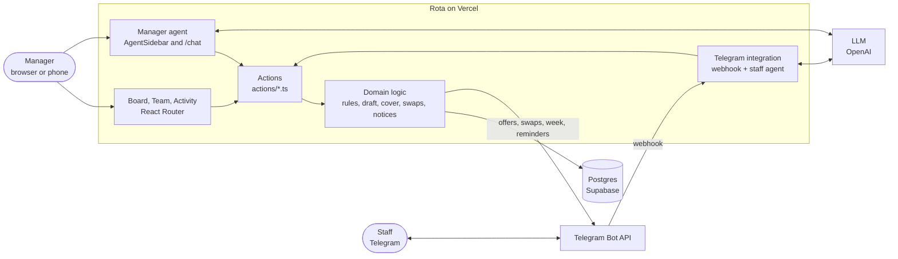
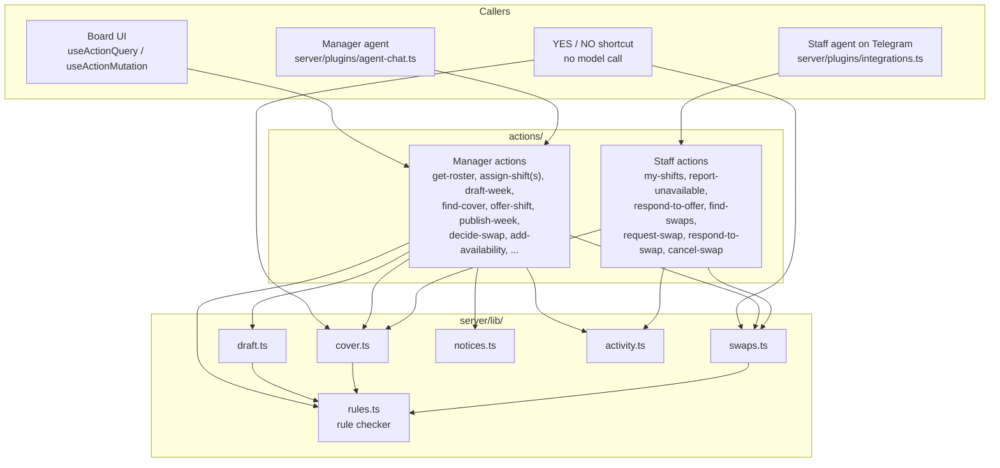
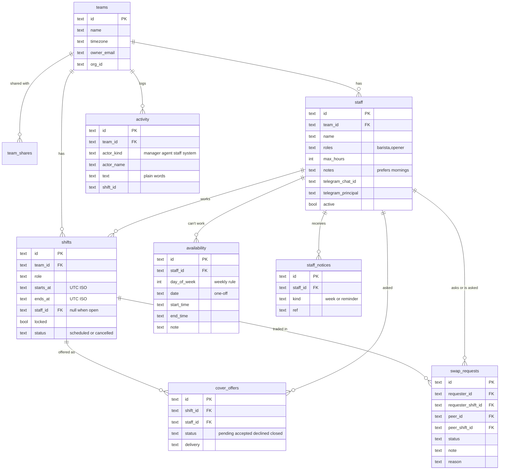
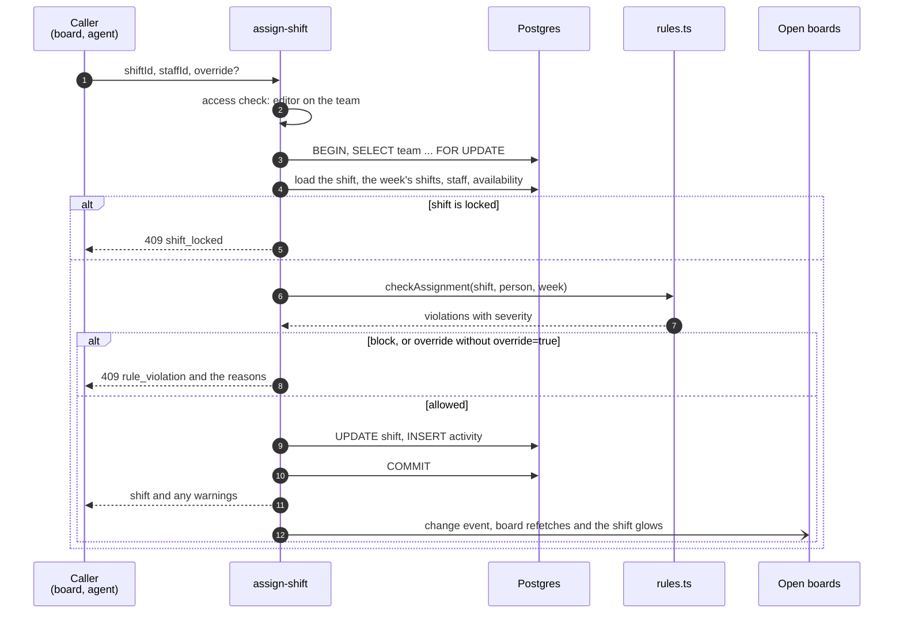
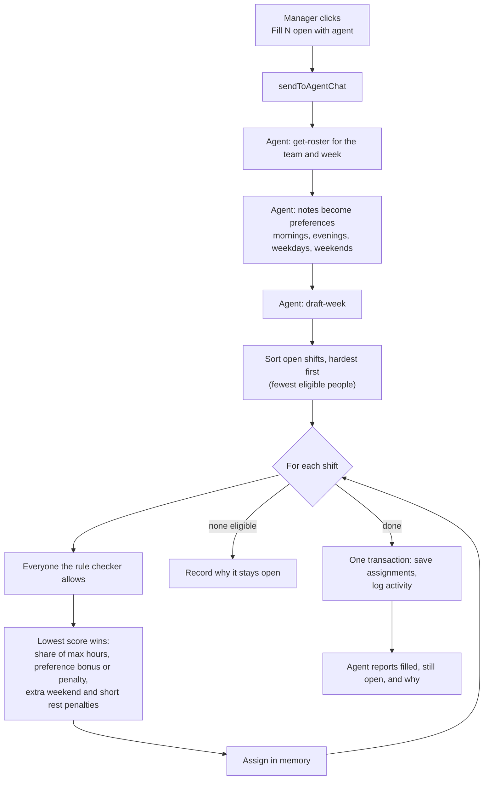
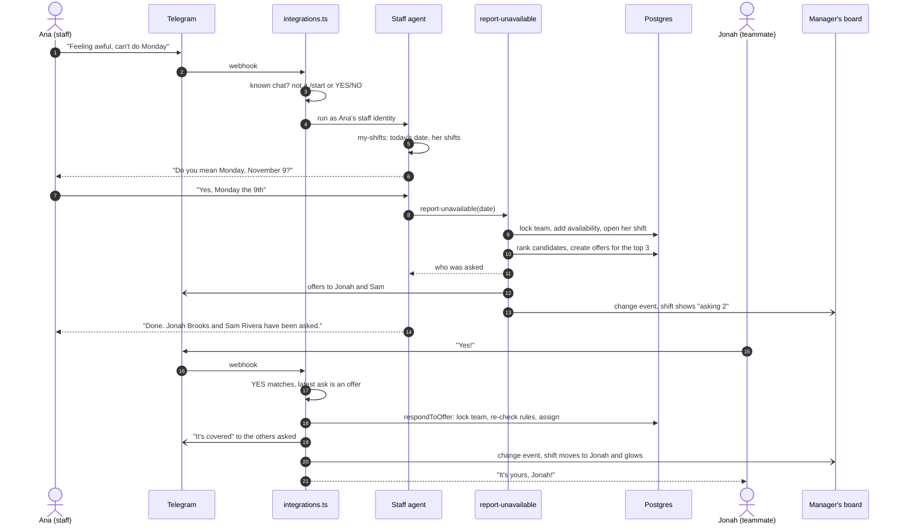
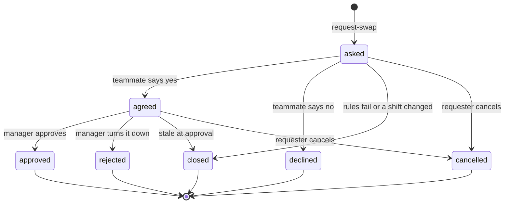
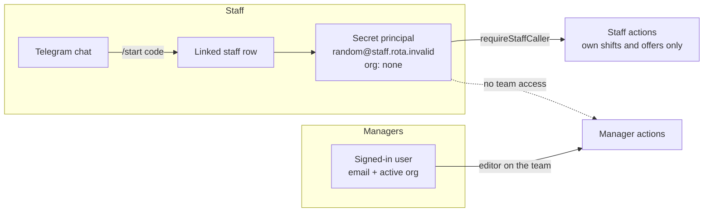
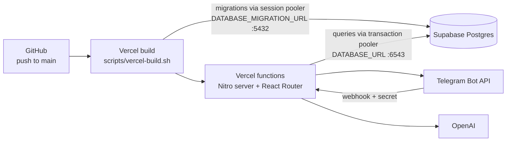

# Rota architecture

Rota is one web app with three ways in: the manager's board, the manager's AI
agent, and a Telegram bot for staff. All three call the same actions, and
every change to who works when passes through one rule checker. This document
explains how those pieces fit together.

- [System overview](#system-overview)
- [One set of actions, three callers](#one-set-of-actions-three-callers)
- [Data model](#data-model)
- [The write path](#the-write-path)
- [The rule checker](#the-rule-checker)
- [Drafting a week](#drafting-a-week)
- [Call-outs and cover](#call-outs-and-cover)
- [Shift swaps](#shift-swaps)
- [Identity and access](#identity-and-access)
- [What the agent sees](#what-the-agent-sees)
- [Live updates](#live-updates)
- [Messages to staff and automations](#messages-to-staff-and-automations)
- [Deployment](#deployment)
- [Code map](#code-map)
- [Testing](#testing)

## System overview



The app is built on [Agent-Native](https://github.com/BuilderIO/agent-native)
(`@agent-native/core`): React Router for the UI, Nitro for the server, Drizzle
for SQL, and the framework's agent chat, integrations, sharing, and sync.

## One set of actions, three callers

Every operation is a file in `actions/` made with `defineAction`. The same
action is a typed client hook for the UI, a tool for the manager's agent, and,
for a small subset, a tool for the staff agent on Telegram. Nothing writes
roster data outside an action except the Telegram YES/NO shortcut, which calls
the same library functions the actions use.



What each caller can reach:

| Capability | Board | Manager agent | Staff on Telegram |
| --- | --- | --- | --- |
| See the week | Board | `get-roster`, `view-screen` | `my-shifts` (own shifts) |
| Assign, move, unassign | Drag, click | `assign-shift`, `assign-shifts` | No |
| Create, edit, lock shifts | Add shift, shift details | `create-shifts`, `update-shift` | No |
| Draft the week | "Fill N open with agent" | `draft-week` | No |
| Record unavailability | Person sheet | `add-availability` | `report-unavailable` (own) |
| Find and ask for cover | Shift details | `find-cover`, `offer-shift` | Answers offers |
| Swaps | Approve or turn down | `list-swaps`, `decide-swap` | Ask, agree, cancel |
| Send the week, reminders | Send to staff, Automate | `publish-week`, `send-shift-reminders` | Receives them |
| History | Activity page | `list-activity` | No |

## Data model

All tables live in Postgres (`server/db/schema.ts`), with additive migrations
in `server/plugins/db.ts`. Times are stored as UTC ISO strings and shown in the
team's time zone.



Every table also carries `owner_email` and `org_id` for the framework's access
checks. `team_shares` is the framework's sharing table; teams are registered
as a shareable resource in `server/db/index.ts`.

## The write path

Every shift write follows the same steps. Here is `assign-shift`, the action
behind a drag on the board, an agent's assignment, and a cover acceptance.



Locking the team row serializes writes per team, so two people (or a person
and the agent) can't both take the last slot. Rejections are HTTP 409 with
`rule_violation` or `shift_locked`, and the board and agent both show the
server's reason.

## The rule checker

`server/lib/rules.ts` is a set of pure functions over rows already in memory,
so the same checks run inside write transactions, in cover ranking, in the
week draft, in swap checks, and in unit tests.

| Rule | Severity | Meaning |
| --- | --- | --- |
| `double_booked` | block | Overlaps another shift the person already works |
| `inactive` | block | The person is no longer active |
| `missing_skill` | override | The shift's role isn't in the person's skills |
| `unavailable` | override | Clashes with a weekly or one-off unavailability |
| `over_max_hours` | override | Takes the person past their weekly max hours |
| `short_rest` | warn | Less than 10 hours between shifts |

`block` never passes. `override` passes only with `override=true`, which the
agent is told to send only when the manager asks for it. `warn` passes and
shows on the board.

Other users of the checker:

- `rankCandidates` orders everyone for a shift: eligible people first, then
  fewest hours this week, then name. `find-cover` and cover offers use it.
- `checkSwap` checks a trade as one change, so each person's hours count the
  shift they give away as gone.

## Drafting a week

"Fill N open with agent" sends a prompt to the manager agent. The agent reads
the roster, turns each person's notes ("prefers mornings") into preferences,
and calls `draft-week` once. `draft-week` is deterministic: the agent supplies
judgment (reading notes, explaining results), and the code supplies the
search.



On the demo café the agent fills 28 of 30 shifts in about 15 seconds and
explains the two it left open: on Saturday, every barista is either
unavailable or would go over their max hours.

## Call-outs and cover

Staff text the bot in their own words. The integration plugin answers
`/start` invite codes, unknown senders, and plain YES/NO replies itself; the
staff agent handles everything else with seven staff-only tools.



First yes wins because every answer takes the team row lock and re-checks the
shift. If everyone asked says no, `respondToOffer` opens the next round with
the next best people. The manager can also ask for cover from the agent
(`find-cover`, then `offer-shift`) or assign someone directly.

## Shift swaps

A staff member can trade a shift with a teammate. `find-swaps` only offers
trades that pass `checkSwap` for both people, the teammate agrees on Telegram,
and the manager approves on the board.



Approval re-checks the rules and swaps both shifts in one transaction under
the team lock, then closes any other open swap that involved either shift.
Both people get a confirmation. A YES or NO on Telegram answers whichever
question that person was sent last, a cover offer or a swap request
(`latestAsk` in `swaps.ts`).

## Identity and access



- Teams are visible to the active organization when there is one, and private
  otherwise. Staff, shifts, and availability inherit the team's access.
  Manager actions declare `access: { scope: "resource", resource: { type: "team" } }`.
- Staff link their Telegram chat with a one-time invite code. Their messages
  run as a secret per-person principal with no organization, so every manager
  action refuses them. Staff actions look the person up from that principal
  and only touch their own shifts, offers, and swaps.
- The Telegram bot token is one deployment-wide credential. Outgoing Telegram
  calls run without a user attached (`server/lib/telegram-adapter.ts`), and
  Rota's actions decide what may be sent before they get there.

## What the agent sees

The board writes its state to the framework's application state, and the
agent reads it on every turn:

- `navigation`: the view, `teamId`, and `week`, in `<current-screen>`.
- `selection:<tab>`: `{kind: "shift", id}` for the shift the manager clicked.
  `view-screen` returns it as `selectedShift`, so "who can cover this?" works.
- `navigate` moves the board to a team and week.

## Live updates

Actions record a change event when they write, and screens subscribed with
`useDbSync` refetch within a second or two. Writes that come from the Telegram
shortcut call `notifyTeamChanged`. On the board, `useJustChanged` gives
shifts that changed while the board was open a short glow, and a "Rota is
working" pill shows while the agent runs.

## Messages to staff and automations

- `publish-week` sends each person their own shifts for the week.
- `send-shift-reminders` reminds everyone working on a date (tomorrow by
  default). `staff_notices` records what was sent, so reruns never send twice.
- The "Automate" menu asks the agent to create a schedule with the
  framework's `manage-automations`: for example every Friday "draft next
  week", or every evening "send reminders". Scheduled runs call the same
  actions.

## Deployment



Environment (names only; values live in Vercel as sensitive variables):
`DATABASE_URL`, `DATABASE_MIGRATION_URL`, `OPENAI_API_KEY`,
`TELEGRAM_BOT_TOKEN`, `TELEGRAM_BOT_USERNAME`, `TELEGRAM_WEBHOOK_SECRET`,
`A2A_SECRET`, `APP_URL`, `DB_OP_TIMEOUT_MS`. Setup steps are in
[docs/ROADMAP.md](docs/ROADMAP.md#telegram-setup-once-per-deployment).

Local development uses PGlite in `data/pglite`, so it needs no database.

`patches/@agent-native__core@0.222.2.patch` fixes production stalls on
serverless Postgres: background writes are registered with Vercel's
`waitUntil` so an instance isn't frozen mid-statement, and a connection that
times out is replaced instead of reused. The details are in
[docs/ROADMAP.md](docs/ROADMAP.md#framework-patch-production-reliability).

## Code map

```text
actions/                 every operation (UI hooks, agent tools, staff tools)
app/routes/              roster.$teamId, staff.$teamId, activity.$teamId, chat
app/components/roster/   board, shift details, person sheet, swaps, Telegram connect
server/db/schema.ts      tables
server/plugins/db.ts     migrations
server/plugins/agent-chat.ts      manager agent: prompt and tools
server/plugins/integrations.ts    Telegram: invites, YES/NO shortcut, staff agent
server/lib/rules.ts      rule checker
server/lib/draft.ts      week draft
server/lib/cover.ts      cover offers and answers
server/lib/swaps.ts      swap requests and approvals
server/lib/notices.ts    published week and reminders
server/lib/activity.ts   activity log and change events
server/lib/telegram*.ts  invite codes, staff identity, bot adapter
scripts/smoke/           end-to-end checks against a running server
.agents/skills/          guides for coding agents, including demo-video
```

## Testing

- `pnpm test`: unit tests for the rule checker and the week draft
  (`server/lib/rules.test.ts`, `server/lib/draft.test.ts`).
- `scripts/smoke/*.cjs`: end-to-end runs against a dev server. They post fake
  Telegram updates for linking, call-outs, cover, and swaps, and check the
  database and replies.
- `pnpm typecheck` and `pnpm agent-native:doctor` (the framework's guards for
  access scoping, credentials, and migrations).
