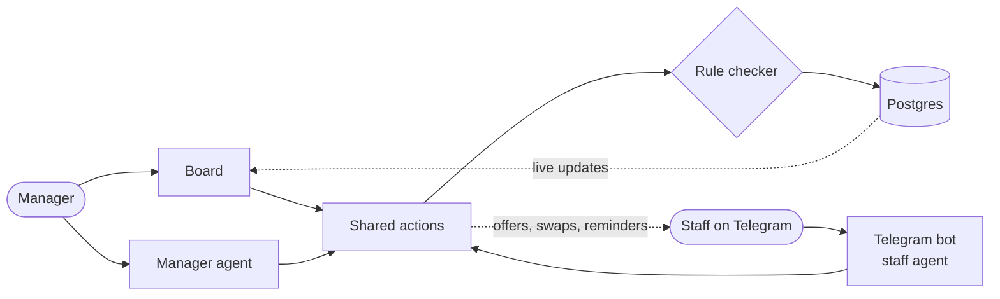

# Rota

**Your AI shift manager.** Rota builds the weekly staff roster with you, keeps
it within your rules, and handles the phone side of scheduling (call-outs,
cover, swaps) over Telegram while you watch the board.

**Live:** https://rota-n45divs-projects.vercel.app

**Demo (2 min):** https://clips.agent-native.com/share/4eqOYMqZXm50

Built on [Agent-Native](https://github.com/BuilderIO/agent-native) for the
[Builder.io Agent-Native Hackathon](https://www.builder.io/hackathon): people
and an agent working on the same roster.

## Why

Small teams such as cafés, clinics, and shops still run on a spreadsheet and a
group chat. The manager spends Friday afternoon fitting people to shifts, then
spends the week on the phone: someone's sick at 6 a.m., someone wants to swap,
and nobody is sure who's working Saturday. Rota does that legwork and leaves the
decisions with the manager.

## What it does

- **Drafts a fair week in seconds.** One click and the agent fills the open
  shifts from skills, availability, max hours, and each person's notes
  ("prefers mornings"), then explains anything it couldn't fill.
- **Keeps the rules, every time.** Every change, whether a drag on the board,
  an agent action, or a staff reply, goes through one rule checker: no
  double-booking, the right skills, availability, weekly hours, and rest
  between shifts. When it says no, it says why.
- **Handles call-outs on Telegram.** Staff text the bot in their own words
  ("feeling awful, can't do Monday"). Rota confirms the day, opens the shift,
  and asks the three best eligible teammates. The first YES gets it.
- **Runs shift swaps.** Staff ask to trade, and Rota only offers swaps that
  pass the rules for both people. The teammate agrees, the manager approves on
  the board, and both get a confirmation.
- **Sends the week.** Each person gets their own shifts on Telegram, plus a
  reminder the night before. Automations can draft every Friday and remind
  every evening.
- **Keeps a plain-language history.** The Activity feed shows what the
  manager, Rota, and staff did, each linked back to the roster.

## A week with Rota

| When | What happens |
| --- | --- |
| Friday | The manager clicks **Fill 30 open with agent**. The agent drafts 28 of 30 shifts and says why two Saturday shifts still need a person. The manager fills those by hand or asks the agent for options. |
| Friday | **Send to staff**: everyone gets their week on Telegram. |
| Sunday evening | With the evening automation on, Rota reminds everyone working Monday. |
| Monday 6 a.m. | Ana texts that she has a fever. Rota opens her shift and asks Jonah and Sam. Jonah says yes, and the board updates before the manager is up. |
| Wednesday | Priya has an exam, so she asks to swap with Jonah's Thursday close. Jonah agrees, and the manager taps **Approve**. |
| Any time | "What happened today?" The agent answers from the activity log. |

## How it works



The board, the manager's agent, and the Telegram bot call the same actions
(`actions/`), and every roster change passes through one rule checker
(`server/lib/rules.ts`) inside a transaction that locks the team. The agent
sees what you're looking at (team, week, selected shift), so "who can cover
this shift?" just works. Changes from Telegram or the agent appear on the open
board within seconds, and the shifts that changed glow.

**[ARCHITECTURE.md](ARCHITECTURE.md)** has the full design with diagrams: the
data model, the write path, the call-out and swap flows, identity and access,
and deployment.

## Agent-native by design

- **One set of actions.** Anything the manager can do on the board, the agent
  can do through the same action, and staff get a small, safe subset on
  Telegram. There is no separate "AI API".
- **Rules in code, judgment in the agent.** The agent reads notes, picks
  options, and explains results. The deterministic draft and rule checker make
  the decisions that must always hold.
- **Shared context.** The board publishes the team, week, and selected shift to
  the agent, and the agent can move the board with `navigate`.
- **Live by default.** Writes from any caller publish a change event, so the
  manager watches the agent and staff work in real time.
- **Safe identities.** Each staff member's Telegram chat runs as their own
  secret identity with no team access, so they can only touch their own
  shifts, offers, and swaps.

## Try it

**Online:** open the live link, sign in, and choose **Load a demo café**. Then
try **Fill N open with agent**, drag a shift onto someone who's already
working, or ask Rota in the sidebar:

- "Draft next week, and keep Maya on mornings."
- "Who can cover this shift?" (with a shift selected)
- "Leo can't work Tuesdays from now on."
- "What happened this week?"

**Locally:**

```bash
pnpm install
pnpm dev
```

Sign in with **Continue as local dev**, then **Load a demo café**. Put
`OPENAI_API_KEY` in `.env` to use the agent. Local development stores data in
PGlite (`data/pglite`), so no database is needed. Telegram setup and production
notes are in [docs/ROADMAP.md](docs/ROADMAP.md).

## Project layout

```text
actions/          every operation: board hooks, agent tools, staff tools
app/              React Router UI: roster board, Team, Activity, chat
server/lib/       rules, week draft, cover, swaps, notices, activity
server/plugins/   database migrations, manager agent, Telegram integration
scripts/smoke/    end-to-end checks with fake Telegram updates
.agents/skills/   guides for coding agents, including demo-video
```

## Checks

```bash
pnpm test                    # rule checker and week draft unit tests
pnpm typecheck
pnpm agent-native:doctor     # framework guards: access, credentials, migrations
```

## Demo video

**Watch it on Clips:** https://clips.agent-native.com/share/4eqOYMqZXm50
(1:55, with voiceover, chapters, and transcript).

The demo film was made by the coding agent with this repo's
[`demo-video` skill](.agents/skills/demo-video/SKILL.md): real screen captures
and real bot messages, cut together with HyperFrames, timed to a voiceover
script, and published on Clips through its MCP server.

## Docs

- [ARCHITECTURE.md](ARCHITECTURE.md): how Rota is built
- [DESIGN.md](DESIGN.md): the visual design contract
- [docs/ROADMAP.md](docs/ROADMAP.md): status, setup, and what's next
- [CHANGELOG.md](CHANGELOG.md)

## Stack

Agent-Native (React Router, Nitro, Drizzle), Postgres on Supabase, Vercel,
OpenAI, and the Telegram Bot API.

## License

[MIT](LICENSE)
